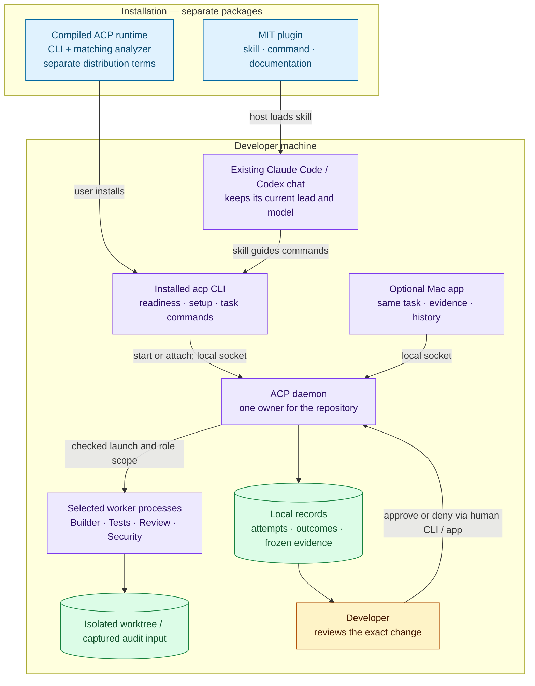
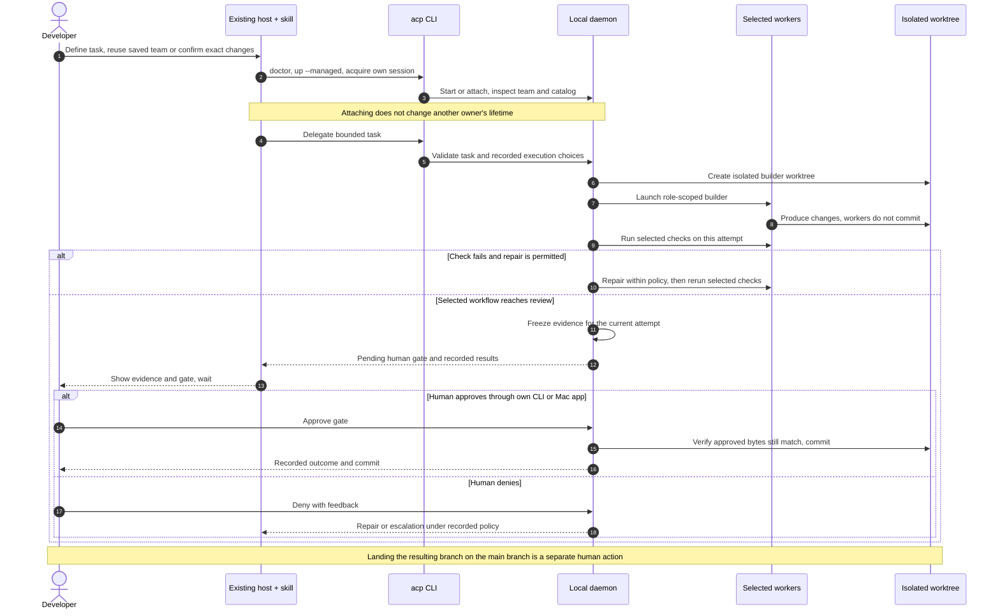

# ACP — keep your conversation, coordinate the work

Use ACP from an existing **Claude Code or Codex conversation** to coordinate selected workers,
inspect their evidence and return the integration decision to you. The optional Mac app shows
the same local task and history.

**This repository contains the free MIT plugin, not the Rust daemon source.** The plugin requires
a separately installed `acp` executable. The engine remains private and is intended for a free
compiled distribution under separate terms. Provider access and usage come from your own accounts.

**Release status:** the MIT plugin is available for preview in this public repository.
The compiled runtime is awaiting the maintainer’s final verification; there is no public runtime
download yet. Existing pilot users can validate it with a
compatible trusted runtime. Installing the plugin alone does not install ACP or start workers.

[Install](docs/INSTALLATION.md) · [Architecture](#architecture) ·
[Compatibility](docs/COMPATIBILITY.md) · [Roadmap](ROADMAP.md) ·
[Contribute](CONTRIBUTING.md) · [License scope](docs/DISTRIBUTION.md) ·
[Final verification](docs/FINAL-VERIFICATION.md)

## What you can do

| Workflow | What happens | What the human decides |
|---|---|---|
| Build | A builder works in an isolated Git worktree; selected tests/reviews follow | Task, team and approval of the frozen change |
| Audit | Selected workers inspect an explicitly chosen snapshot | Comparison base and input; there is no integration |
| Plan | Discuss a plan in your current conversation | Direction and next action; no writing workers |
| Inspect | Read task status, evidence and history | Whether to continue, request changes or stop |

The current conversation remains the lead with its existing model. The connected daemon's
catalog determines supported worker choices. Disabling a check leaves it explicitly unperformed;
it does not count as a pass. ACP uses a local daemon for worktree isolation, coordination,
recorded results, recovery and human gates. Launching a model alone does not provide those controls.

Example request after installation and setup:

> Use ACP for this repository. Inspect readiness and the saved team first, then help me define
> a small task. Keep this conversation as the lead and show me the evidence before integration.

No new paid feature or subscription is required by this plugin. Proposed paid understanding
features are described separately in the [roadmap](ROADMAP.md).

## Architecture

### HLD — three pieces, one local task

The marketplace supplies instructions; a separate binary package supplies the runtime. The Mac
app is another client of that runtime. A task link does not transfer the host's complete chat.



### LLD — one build attempt, from request to decision

The diagram shows a build with enabled checks. The exact worker set comes from the saved team.
The skill uses CLI commands; optional MCP wiring is a separate entry choice, not an installer hook.



An agent must never approve integration. MCP refuses agent approval; on the skill's shell path,
this is an instruction boundary. The local socket identifies the OS user, not a physical human.
See [security boundaries](SECURITY.md) before assuming stronger isolation between same-user processes.

## Package layout

```text
acp-plugin/
├── .claude-plugin/marketplace.json   # Claude catalog
├── .agents/plugins/marketplace.json # Codex catalog
├── plugins/acp/
│   ├── plugin.json                  # Portable identity
│   ├── .claude-plugin/plugin.json   # Claude metadata
│   ├── .codex-plugin/plugin.json    # Codex compatibility metadata
│   ├── skills/acp-control-plane/SKILL.md
│   ├── commands/acp.md
│   └── LICENSE                     # Retained when a host copies the plugin
├── docs/                            # Install, compatibility and release guidance
├── scripts/check_package.py         # Local package checks; no downloads
├── CONTRIBUTING.md
└── LICENSE                          # MIT for this repository's files
```

The plugin contains no daemon binary, daemon source, provider credentials, startup hooks or
automatic MCP configuration. The [distribution guide](docs/DISTRIBUTION.md) explains the license
boundary and why compiled delivery does not prevent reverse engineering.

## Development

With Python 3.10 or later, run `python3 scripts/check_package.py` from this repository. With
Claude Code installed, run `claude plugin validate .` and
`claude plugin validate ./plugins/acp`. Read [CONTRIBUTING.md](CONTRIBUTING.md) for scope and review.
These checks do not start a daemon, run a model or prove installed runtime compatibility.
