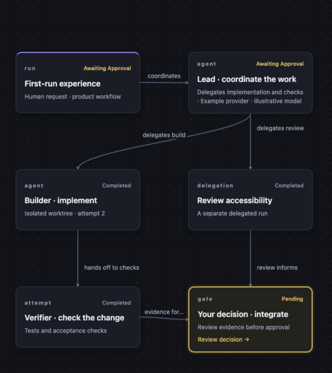
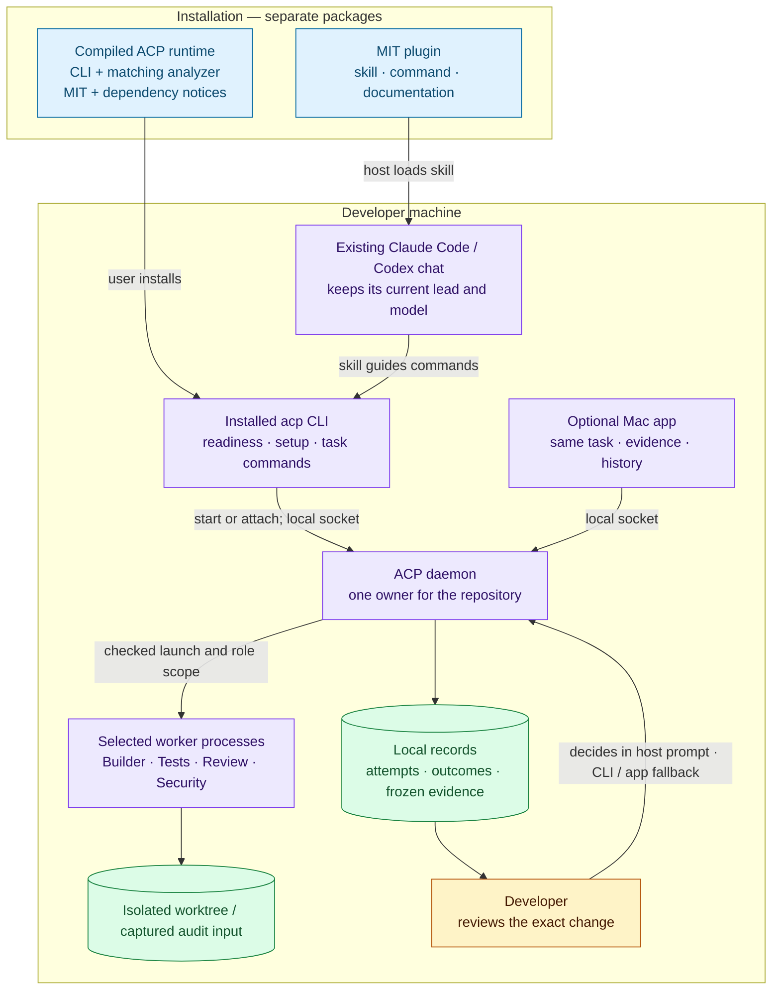
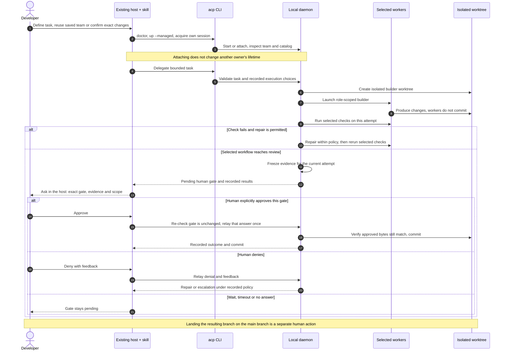

# ACP — keep your conversation, coordinate the work

Delegate work from the **Claude Code or Codex conversation you already use**. Choose which
tests and reviews must pass and who can approve the result. ACP creates a local commit in
the task worktree from the exact change approved for that run.

**Free and MIT:** this repository supplies the host plugin and installer. The
[Rust core and matching Swift analyzer](https://github.com/Vvlladd/acp-core) are also public under
MIT. The skill needs the installed daemon. The optional Mac app remains private and is not
required. Provider access and usage come from your own accounts.

**Release status:** the free compiled daemon/helper is available as an
[Apple Silicon preview](https://github.com/Vvlladd/acp-core/releases/tag/runtime-v0.1.0-preview.20261123).
The Mac app is optional and is not included. This preview is ad hoc signed and **not notarized**;
macOS may block downloaded binaries. Read the [installation guide](docs/INSTALLATION.md) and
[signing status](docs/SIGNING.md) before installing.

[Install](docs/INSTALLATION.md) · [Architecture](#architecture) ·
[Compatibility](docs/COMPATIBILITY.md) · [Roadmap](ROADMAP.md) ·
[Contribute](CONTRIBUTING.md) · [License scope](docs/DISTRIBUTION.md) ·
[Final verification](docs/FINAL-VERIFICATION.md)

The November preview supports worker transcripts and per-run lead decisions. Start the
optional browser map from this repository to follow a task. [Workflow map guide](workflow-map/README.md)

[](docs/media/workflow-map.mp4)

[Watch the example workflow map (6 seconds, MP4)](docs/media/workflow-map.mp4). The replay
shows the animated handoff from the lead to the builder and the human integration decision.

## Choose a workflow in Codex or Claude

In a fresh local chat, invoke the **acp-control-plane** skill in Codex or type `/acp:acp`
in Claude Code. For a new task with no workflow specified, the skill asks **How should we
run this task?** in the host’s question picker. Hosts without a picker ask in chat.

| Choose | Who does the work and who decides |
|---|---|
| Direct coding | Your current chat implements the task with its native tools. |
| QRSPI | You approve the requirements, research, design and task plan before implementation, then review each completed task. |
| ACP · I approve | The lead delegates to ACP workers and brings you the checked change for approval. |
| ACP · lead approves | After you confirm the named run in macOS, the lead can decide plans and approve the verified local worktree commit. Escalations still come to you. |

**When you want to shape the work up front**, choose QRSPI in the picker or say
**“Use QRSPI for this feature.”** Install the separate QRSPI plugin in your host to use
this option. Its phase approvals stay with you. [QRSPI plugin](https://github.com/Vvlladd/qrspi-orchestrator)

**When you want to delegate a defined task**, you can say **“Keep Claude as lead, use Codex
as the builder, run the tests, and let the lead approve this run.”** Suppose Codex edits a
file after the tests pass. ACP rejects the old evidence and requires the selected checks
for the revised patch before the lead can approve it. ACP records who approved the change.
If the lead retries after losing the reply, it gets the original commit back.
[Per-run approval contract](https://github.com/Vvlladd/acp-core/blob/5a38b0965cbf7617a7ad81162faa360d3fd4ac77/docs/PROTOCOL.md#lead-approval-for-one-run)

Ordinary chats follow their existing project instructions. Status checks and follow-ups continue directly.

## Quick setup

```sh
git clone https://github.com/Vvlladd/acp-plugin.git
cd acp-plugin
bash scripts/setup.sh --host claude
```

Use `--host codex` for Codex. Review `scripts/setup.sh` and `scripts/install-runtime.sh` before
running them. Setup installs the pinned runtime and selected host plugin, then prints the PATH
line to activate this terminal. It does not run a model or modify shell profiles. Start a fresh
host conversation after checking `acp doctor`. For manual steps, source builds and preview limits,
read [installation](docs/INSTALLATION.md).

## What you can do

| Workflow | What happens | What the human decides |
|---|---|---|
| Build | A builder works in an isolated Git worktree; selected tests/reviews follow | Task, team and approval of the frozen change |
| Audit | Selected workers inspect an explicitly chosen snapshot | Comparison base and input; there is no integration |
| Plan | Discuss a plan in your current conversation | Direction and next action; no writing workers |
| Inspect | Read task status, evidence and history | Whether to continue, request changes or stop |

The current conversation remains the lead with its existing model. The connected daemon's
catalog determines supported worker choices. Disabling a check leaves it explicitly unperformed;
it does not count as a pass. ACP uses a local daemon for worktree isolation, coordination,
recorded results, recovery and human gates. Launching a model alone does not provide those controls.

Example request after installation and setup:

> Use ACP for this repository. Inspect readiness and the saved team first, then help me define
> a small task. Keep this conversation as the lead and show me the evidence before integration.

No new paid feature or subscription is required by this plugin. Proposed paid understanding
features are described separately in the [roadmap](ROADMAP.md).

## Architecture

### HLD — three pieces, one local task

The marketplace supplies instructions; a separate binary package supplies the runtime. The Mac
app is another client of that runtime. A task link does not transfer the host's complete chat.



### LLD — one build attempt, from request to decision

The diagram shows a build with enabled checks. The exact worker set comes from the saved team.
The skill uses CLI commands; optional MCP wiring is a separate entry choice, not an installer hook.



In the host skill's default workflow, an agent does not independently approve integration. When a review gate is ready, the host asks the human in
its own UI — a native question prompt where the host permits one (Codex desktop
`request_user_input_async`, Claude Code `AskUserQuestion`), otherwise an explicit chat reply — and relays only that fresh
answer for the exact, re-checked gate through the existing `acp gate approve` CLI. A timeout,
auto-continue, missing answer, automatic command reviewer or worker-authored text never counts.
Your own shell and the optional Mac app remain fallbacks. Approval commits on the run branch only;
landing on `main` and publishing stay separate. Direct MCP refuses agent approval; on the skill's shell
path this is an instruction boundary. The local socket identifies the OS user, not a physical human.
See [security boundaries](SECURITY.md) before assuming stronger isolation between same-user processes.

## Package layout

```text
acp-plugin/
├── .claude-plugin/marketplace.json   # Claude catalog
├── .agents/plugins/marketplace.json # Codex catalog
├── plugins/acp/
│   ├── plugin.json                  # Portable identity
│   ├── .claude-plugin/plugin.json   # Claude metadata
│   ├── .codex-plugin/plugin.json    # Codex compatibility metadata
│   ├── skills/acp-control-plane/SKILL.md
│   ├── commands/acp.md
│   └── LICENSE                     # Retained when a host copies the plugin
├── docs/                            # Install, compatibility and release guidance
├── workflow-map/                    # Optional local browser viewer and tests
├── scripts/install-runtime.sh       # Explicit download + checksum-verified install
├── scripts/check_package.py         # Local package checks; no downloads
├── CONTRIBUTING.md
└── LICENSE                          # MIT for this repository's files
```

The plugin contains no bundled daemon, provider credentials, startup hooks or
automatic MCP configuration. The [distribution guide](docs/DISTRIBUTION.md) explains the license
boundary between the MIT core/plugin and private Mac app.

## Development

With Python 3.10 or later, run `python3 scripts/check_package.py` from this repository. Run
`node --test workflow-map/test/*.test.mjs` for the viewer (local socket access required). With
Claude Code installed, run `claude plugin validate .` and
`claude plugin validate ./plugins/acp`. Read [CONTRIBUTING.md](CONTRIBUTING.md) for scope and review.
These checks do not start a daemon, run a model or prove installed runtime compatibility.
